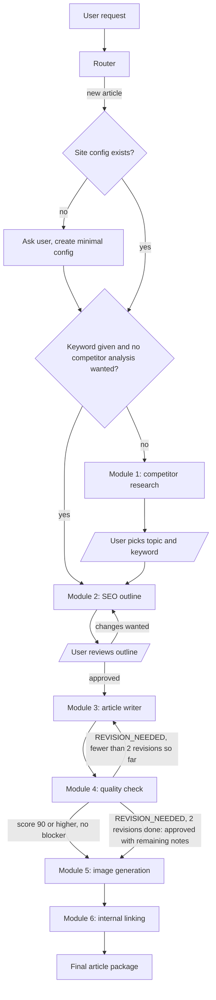
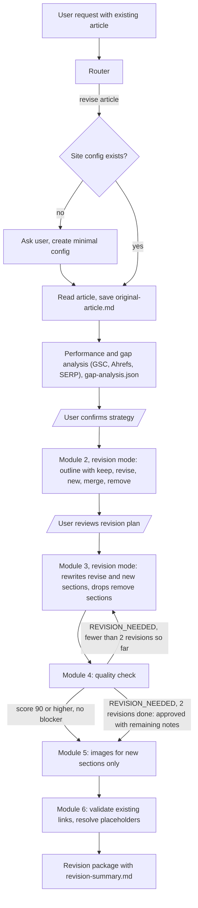

# seo-blog-pipeline

LLM orchestration for SEO blog articles of online shops, split into stages: competitor analysis, outline, article, quality check, images and internal linking. The stages are plain Markdown skills for Claude. A router picks the workflow, two orchestrators chain the stages, and one JSON file per website holds the site-specific settings.

The skills, the style guide and the word blacklist are written in German and aim at German-language shop blogs. This README is in English. See "Other languages" below.

## Why it exists

The pipeline was written in 2026 for the blog work of online shops. One article needs several different jobs: finding a topic, planning the headings, writing, checking against style rules, producing images and linking to pages that really exist. Here every stage has defined inputs and outputs, so a run can be inspected stage by stage, and a failed quality check sends the article back to the writer instead of ending the run.

## Structure

```
ROUTER.md                     entry point: classifies the request, checks for a site config
ARCHITECTURE.md               overview, input/output chain, external tools
config/
  SITE-CONFIG.md              template and field reference for the per-site JSON
  style-guide.md              writing rules shared by all sites
  blacklist-words.md          forbidden words, phrases, punctuation and sentence structures
  sites/example-shop-example.json  example site config (fictional shop)
orchestrators/
  new-article/SKILL.md        new article: modules 1 to 6
  revise-article/SKILL.md     existing article: performance and gap analysis, then modules 2 to 6
modules/
  competitor-research/        module 1
  seo-outline/                module 2
  article-writer/             module 3
  quality-check/              module 4
  image-generation/           module 5
  internal-linking/           module 6
.claude-plugin/plugin.json    plugin manifest
```

- **Router** (`ROUTER.md`): sends a request to `new-article`, to `revise-article` or directly to a single module. If no site config exists for the domain, it asks a few questions and creates a minimal one.
- **Orchestrators**: run the modules in order, stop at the points where the user has to decide, and handle the quality-check loop.
- **Modules**: one skill per stage. Competitor research (Ahrefs data), SEO outline (keyword map, SERP analysis, headings), article writer, quality check, image generation, internal linking.
- **Site config**: one JSON file per website with domain, language, URL patterns for blog, category and product pages, primary topics, competitors, tone and the limits for internal links. Field reference: `config/SITE-CONFIG.md`.
- **Quality gates**:
  - The style guide and the blacklist are applied while writing and checked again in module 4.
  - Module 4 starts at 100 points and deducts 15 per blocker and 5 per warning. An article is approved with a score of at least 90 and no blocker. Otherwise it goes back to the writer together with `revision-notes.md`, at most twice. After the second revision the article moves on with the remaining notes. The exact rules are in `modules/quality-check/SKILL.md`.
  - The writer never sets real internal URLs. It sets `[INTERNER_LINK: anchor | topic]` placeholders, and module 6 replaces them only with URLs it has fetched and validated.
  - `new-article` stops for the user after the topic and keyword choice (skipped when the competitor analysis is skipped) and after the outline. `revise-article` stops after the gap analysis and after the revision outline.

## Flow

The diagrams follow `ROUTER.md`, `ARCHITECTURE.md` and the two orchestrator skills.

### new-article



### revise-article



## Requirements

The skills call tools by name. These names come from the environment the pipeline was developed in, and the repository does not ship any of these tools. Without them the matching stage cannot run as written; replace the tool calls in the skill with your own equivalents.

| Used in | Name in the skills | What it is |
|---|---|---|
| Module 1, module 2, revise step 1 | `ahref:site-explorer-metrics`, `ahref:site-explorer-top-pages`, `ahref:site-explorer-organic-keywords`, `ahref:keywords-explorer-overview`, `ahref:keywords-explorer-related-terms`, `ahref:keywords-explorer-search-suggestions`, `ahref:serp-overview` | Ahrefs MCP server (needs an Ahrefs account). The prefix is `ahref:`, as in the skills. |
| Module 2 step 4, revise step 1 | `gsc:search_analytics` | Google Search Console MCP server with access to the site property. |
| Modules 2 and 6, revise step 0 | `web_fetch` | Fetching web pages, a generic tool of the host. |
| Modules 3 and 4, fallback for the sitemap crawl in module 6 | `web_search` | Web search, a generic tool of the host. |
| Module 5 | `nano-banana-pro:generate_image`, `nano-banana-pro:describe_image` | An image MCP server from the original environment. The skill describes it as Gemini image generation. No endpoint or key is part of this repository. |

Module 5 writes images to `/home/claude/seo-blog-pipeline/output/images/`. That path follows the layout of the original sandbox; change `outputPath` in `modules/image-generation/SKILL.md` to a folder of your own.

No credentials are stored in this repository. API keys belong to the configuration of the MCP servers you use. `orchestrators/new-article/SKILL.md` ends with a table of the estimated API usage per article.

## Usage

This started as a Claude plugin (`.claude-plugin/plugin.json`), but the skills are plain Markdown files. The skills refer to each other and to the configuration by paths relative to the repository root, for example `/modules/competitor-research/SKILL.md` and `/config/sites/[domain].json`.

**Working from a checkout.** This is the workflow the files describe. Clone this repository (`git clone https://github.com/withus/seo-blog-pipeline.git`), start Claude in the checkout, ask for an article and have it read `ROUTER.md` first. `ROUTER.md` itself asks for that.

**As a Claude Code plugin.** The plugin documentation (https://code.claude.com/docs/en/plugins/manifest-reference.md) expects skills in `skills/<name>/SKILL.md` or in directories listed in the `skills` field of the manifest. This repository keeps the original layout with the skills under `modules/` and `orchestrators/`. The manifest therefore lists both directories in its `skills` field:

```json
"skills": ["./modules/", "./orchestrators/"]
```

A plugin directory can be loaded for one session with `claude --plugin-dir ./seo-blog-pipeline` (also from the documentation). `ROUTER.md` lies outside these two directories and is not a `SKILL.md`, so in plugin mode the router is not registered as a skill; start with the `new-article` or `revise-article` skill instead, or work from a checkout. Loading the skills this way was not tested in a live session for this repository. The path references between the skills stay as written, so the working directory still has to be the repository root for them to resolve.

**As copied skills.** Each folder with a `SKILL.md` can also be copied into a `skills/` directory. The references between the skills would then need to be adjusted by hand.

The pipeline was not re-run end to end after the clean-up for publication.

## Create a site config

1. Copy `config/sites/example-shop-example.json` to `config/sites/<domain-slug>.json`. The slug is the domain with dots replaced by hyphens (`ROUTER.md`), so the example for the fictional domain `example-shop.example` is named `example-shop-example.json`.
2. Fill in the fields as described in `config/SITE-CONFIG.md`: domain and language, URL patterns for blog, category and product pages, primary topics, competitors, tone (`du-form`, `sie-form` or `neutral`) and the limits for internal links.
3. If you skip this, the router asks for language, form of address, main topics, competitors and Search Console access, and creates a minimal config with `null` for unknown fields. `known_urls` is filled by module 6 while it crawls the sitemap.

## Other languages

Language and tone are set per site (`language`, `tone`). The shipped style guide and blacklist, however, contain German rules and German word lists. For another language, write your own versions of `config/style-guide.md` and `config/blacklist-words.md` and point `style.style_guide` and `style.blacklist` in the site config to them. The skills themselves, including the examples and the placeholder `[INTERNER_LINK: ...]`, are in German as well.

## License

MIT, see `LICENSE`.
